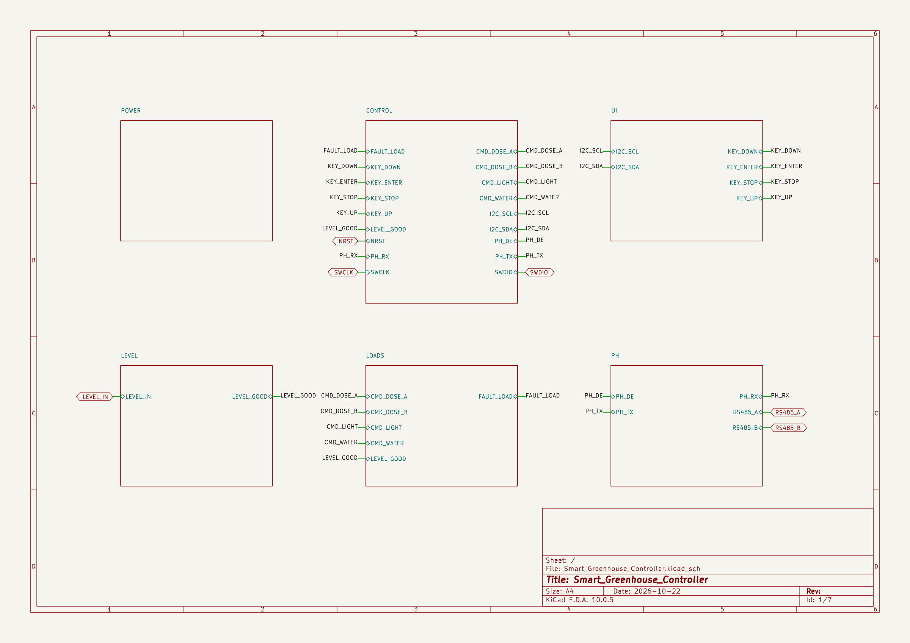
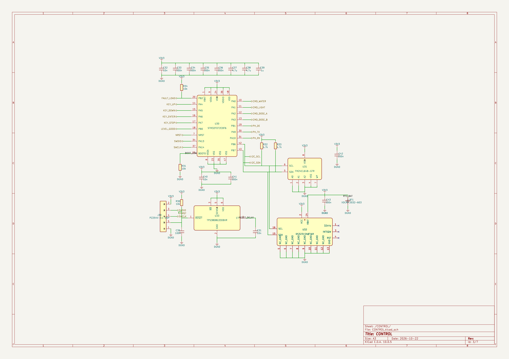
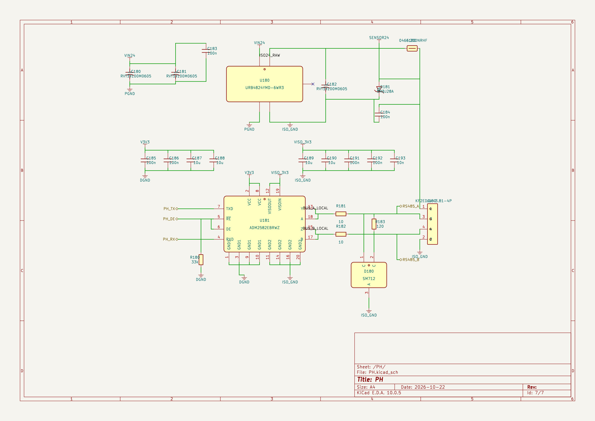

# Smart Greenhouse Controller

This repository documents two hardware revisions of a SpeedUp-generated greenhouse controller for watering, lighting, timed nutrient dosing, and pH monitoring. V1 contains the earlier ESP32-S3 schematic; V2 is an STM32F072-based redesign with local controls and an isolated RS-485 sensor interface.

[Download v0.2.0](https://github.com/SpeedUp-Tech/24v-esp32-greenhouse-controller-kicad-schematic/releases/tag/v0.2.0) · [Explore the earlier ESP32 demo](https://speed-up.ai/demo/smart-greenhouse-hydroponics-controller/) · [Read the earlier ESP32 case study](https://speed-up.ai/blog/24v-esp32-greenhouse-controller-kicad-project/)

## At a glance

| Item | v0.2.0 supplied design |
| --- | --- |
| Main controller | STM32F072CBT6 |
| Power | Nominal 24 V input; protected distribution, 5 V, 3.3 V, and local 3.0 V rails |
| Outputs | Four protected high-side channels: water, lighting, nutrient A, nutrient B |
| Reservoir interface | Float-switch input with a hardware permissive for watering and dosing |
| pH interface | Isolated RS-485 interface for an external powered pH transmitter |
| Local operation | OLED, four buttons, DS3231 RTC, FM24CL64B FRAM, and SWD service header |
| Editable schematic | One root sheet and six module sheets; opened and exported using KiCad 10.0.5 |
| Supplied CSV BOM | 52 grouped rows totaling 143 component references |
| Engineering status | Draft for review; ERC reports 13 errors and 94 warnings |

## Hardware revisions

| Design revision | Controller | Design files and PCB relationship | Release |
| --- | --- | --- | --- |
| V1 — earlier design | ESP32-S3 | Earlier schematic retained for reference; no PCB included in its public package | [v0.1.1](https://github.com/SpeedUp-Tech/24v-esp32-greenhouse-controller-kicad-schematic/releases/tag/v0.1.1) |
| V2 — current design | STM32F072 | Current schematic; the supplied PCB layout was developed from this V2 schematic | [v0.2.0](https://github.com/SpeedUp-Tech/24v-esp32-greenhouse-controller-kicad-schematic/releases/tag/v0.2.0) |

V2 is an STM32F072-based redesign of the greenhouse controller. The PCB layout was developed from the V2 schematic. The earlier ESP32-S3 schematic is retained as V1 for reference. The supplied PCB belongs to V2 and must not be paired with the V1 schematic or BOM.

V1 and V2 identify hardware design revisions; `v0.1.1` and `v0.2.0` identify repository release packages. The current public download contains the V2 schematic and BOM alongside the historical V1 files. The V2 PCB and standalone libraries are not included in this public package; see [PCB availability](#pcb-availability).

The repository URL retains its historical `24v-esp32` name. The current design uses STM32F072 and is an architectural replacement, not a pin-compatible update to the ESP32 board. The earlier ESP32-S3 design is retained unchanged in `hardware/24V_Greenhouse_Controller.kicad_pro` and its existing module folder; its BOM remains `bom/BillOfMaterials.csv`. See the [earlier design overview](docs/ESP32-v0.1.1-README.md) and [v0.1.1 release](https://github.com/SpeedUp-Tech/24v-esp32-greenhouse-controller-kicad-schematic/releases/tag/v0.1.1).

The linked Blog and public Demo still describe that earlier ESP32 design. They are historical project context and do not show the new STM32 schematic.

## Project scope

The source design report records this requirement: 24V smart greenhouse and hydroponics controller featuring automatic watering, supplemental lighting, nutrient solution control, and pH monitoring. It matches the requirement preserved in [PRODUCT_REQUIREMENT.md](PRODUCT_REQUIREMENT.md).

The new implementation provides standalone local operation, sequential time-based nutrient dosing, reservoir-level interlocking, and an isolated interface to an external pH instrument. The supplied report specifies target channel currents of 2 A for water, 4 A for lighting, and 0.5 A each for nutrient A and B, with dosing channels intended to run sequentially. These are design targets, not validated ratings.

The new design does not provide the older direct-electrode pH front end, built-in EC measurement, or ESP32 wireless connectivity. Firmware for scheduling, dose accounting, display behavior, and Modbus communication is not included.

## Schematic structure

| Sheet | Contents |
| --- | --- |
| `POWER` | Fused 24 V input, reverse-polarity protection, 5 V buck, and 3.3 V regulation |
| `CONTROL` | STM32F072, RTC, FRAM, supervisor, service interface, command and fault signals |
| `UI` | OLED interface, local 3.0 V supply, level translation, and four buttons |
| `LEVEL` | Float-switch protection, filtering, and level permissive logic |
| `LOADS` | Four TPS26630-based high-side channels with command gating and inductive clamps |
| `PH` | Isolated sensor power and ADM2582E RS-485 interface |

## Repository contents

| Path | Contents |
| --- | --- |
| `hardware/smart-greenhouse-controller/` | Current project and seven schematic sheets, copied without circuit edits |
| `bom/Smart_Greenhouse_Controller.csv` | Current supplied BOM |
| `evidence/smart-greenhouse-*.png` | Images exported from the current schematic |
| `hardware/24V_Greenhouse_Controller.kicad_pro` | Legacy ESP32 project |
| `docs/ESP32-v0.1.1-*` | Legacy overview and engineering limitations |
| `LICENSES/`, `provenance/` | Existing license texts and updated scope/source records |

### PCB availability

The supplied V2 source bundle includes a PCB with placed footprints and routed copper, developed from the V2 STM32F072 schematic. Its presence does not establish fabrication readiness or successful hardware testing.

That PCB and the standalone symbol/footprint libraries are excluded from this public schematic package because their upstream redistribution provenance is not established, following the existing repository's publication scope. Mapping tables, source PDF/XLSX files, PCB render/rules, local state, and internal review notes are also excluded. See [the exclusion inventory](provenance/EXCLUDED_ASSETS.md).

## Open in KiCad

1. Download and extract the v0.2.0 release or clone this repository.
2. Open `hardware/smart-greenhouse-controller/Smart_Greenhouse_Controller.kicad_pro` in KiCad 10. The supplied schematic format identifies KiCad 9 generation; this package was checked with KiCad 10.0.5.
3. Inspect all six hierarchical sheets using their embedded symbol data. Standalone symbol/footprint libraries are not supplied; establish appropriate libraries before library-dependent updates or PCB development.
4. Review ERC findings, pin mappings, footprints, power assumptions, and actual component documentation before downstream work.

## Bill of materials

The current supplied CSV has 52 grouped rows totaling 143 component references. It is preserved without edits and is a design-review aid, not a verified purchasing list. Regenerate and reconcile the BOM after circuit changes; do not use the legacy ESP32 BOM for the current design.

## Engineering status

All seven current schematic pages export successfully. KiCad 10.0.5 reports 13 ERC errors and 94 warnings with the supplied configuration. This update preserves those findings and does not claim electrical validation, firmware completion, fabrication readiness, safety certification, or production sign-off. See [ENGINEERING_LIMITATIONS.md](ENGINEERING_LIMITATIONS.md).

## Licensing and provenance

The existing repository's license scope is retained: SpeedUp-owned hardware design files under [CERN-OHL-P-2.0](LICENSE), and original documentation and images under [CC BY 4.0](LICENSES/CC-BY-4.0.txt). Third-party materials retain their own terms. See [LICENSE_SCOPE.md](LICENSE_SCOPE.md) and [THIRD_PARTY_NOTICES.md](THIRD_PARTY_NOTICES.md).

## About SpeedUp

SpeedUp is an AI schematic generator that turns product requirements into structured schematic sheets and an editable KiCad project for engineering review.

## Project links

The Blog and Demo below describe the legacy ESP32 revision; the current STM32 files are in this repository's v0.2.0 package.

- https://speed-up.ai/blog/24v-esp32-greenhouse-controller-kicad-project/
- https://speed-up.ai/demo/smart-greenhouse-hydroponics-controller/
- https://speed-up.ai/

KiCad is a trademark of the KiCad project. SpeedUp is independent and is not affiliated with or endorsed by the KiCad project.
