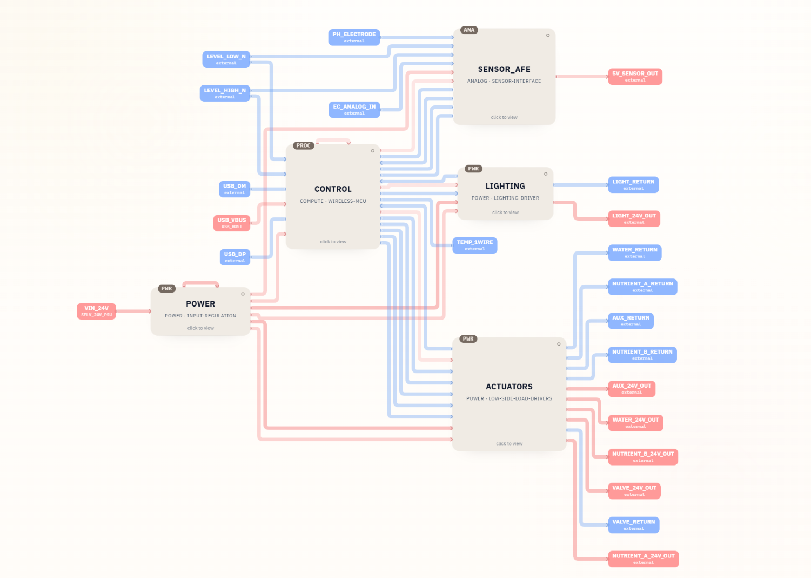
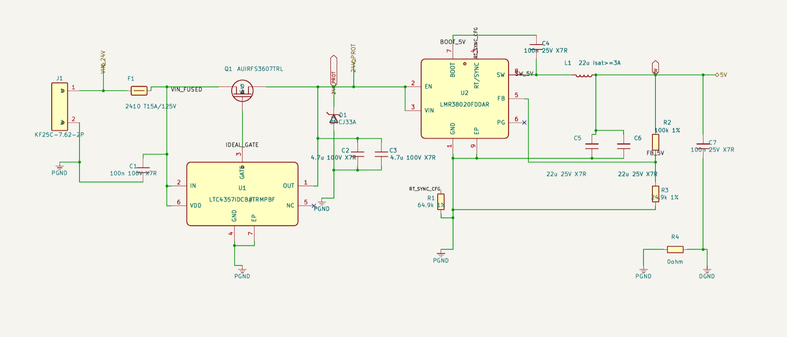
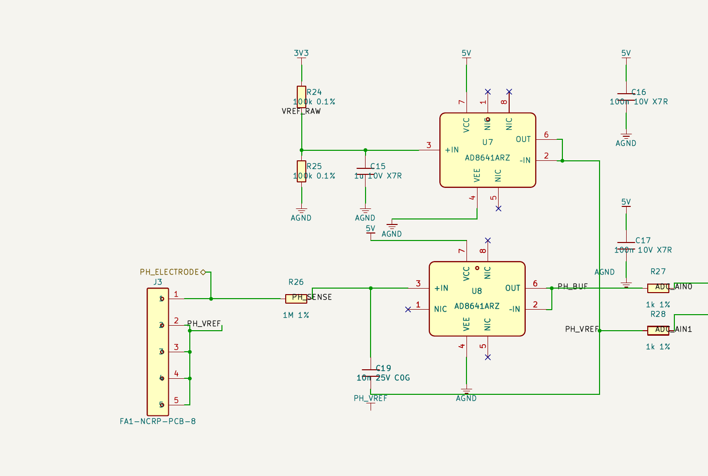

# 24V ESP32 Greenhouse Controller KiCad Schematic

Generated with SpeedUp from a product requirement, this repository contains an editable hierarchical KiCad schematic for a 24V greenhouse and hydroponics controller built around the ESP32-S3. It separates power, control, sensing, lighting, and actuator functions into reviewable engineering sheets.

[Download v0.1.1](https://github.com/SpeedUp-Tech/24v-esp32-greenhouse-controller-kicad-schematic/releases/tag/v0.1.1) · [Open the live demo](https://speed-up.ai/demo/smart-greenhouse-hydroponics-controller/) · [Read the project case study](https://speed-up.ai/blog/24v-esp32-greenhouse-controller-kicad-project/)

## At a glance

| | |
| --- | --- |
| Main controller | ESP32-S3-WROOM-1-N8 |
| Input and rails | Nominal 24 V input with protected 24 V, 5 V, and 3.3 V rails |
| Controlled loads | Water pump, valve, nutrient A, nutrient B, auxiliary load, and supplemental lighting |
| Sensor interfaces | Direct pH probe path, conditioned EC input, two level inputs, and 1-Wire temperature input |
| Project format | KiCad 10 project with one top-level sheet and five editable hierarchical sheets |
| BOM | 59 grouped rows covering 143 placed references |
| Status | Schematic-stage draft for engineering review |

## Project scope

The original public requirement asks for a 24V smart greenhouse and hydroponics controller featuring automatic watering, supplemental lighting, nutrient solution control, and pH monitoring.

SpeedUp turned that brief into named power rails, module boundaries, controller signals, sensor interfaces, protected load channels, and editable KiCad source. The complete public requirement is preserved in [PRODUCT_REQUIREMENT.md](../PRODUCT_REQUIREMENT.md).

Editorial engineering review corrected three definite schematic handoff errors before this release: the global `5V` and `24V_PROT` rails are explicitly continuous across the hierarchy, and the LMR38020 `RT/SYNC` pin is connected to its 64.9 kΩ timing resistor. The lighting fuse is marked `Fuse rating TBD` until the actual fixture, cable, connector, capacitance, and inrush current are defined.

## Schematic structure

| Sheet | Contents |
| --- | --- |
| `POWER` | 24 V input, fuse, ideal-diode protection, transient suppression, and 5 V buck conversion |
| `CONTROL` | ESP32-S3, USB-C, 3.3 V regulation, I2C, sensor signals, command outputs, and fault inputs |
| `SENSOR_AFE` | pH signal conditioning, ADS1115 conversion, conditioned EC input, level inputs, 1-Wire temperature, and switched sensor power |
| `LIGHTING` | Dedicated 24 V lighting channel, PWM buffering, protection, and thermal fault sensing |
| `ACTUATORS` | Five low-side 24 V channels for watering, valve, nutrient A/B, and auxiliary loads |

The pH front end is shown separately at a readable scale because probe leakage, bias current, reference quality, input range, and mixed-signal grounding need focused engineering review.

## Repository contents

| Path | Contents |
| --- | --- |
| `hardware/` | Top-level KiCad project and five editable hierarchical schematic sheets |
| `bom/` | CSV bill of materials for engineering review |
| `evidence/` | Public requirement image, block diagram, and readable KiCad schematic excerpts |
| `LICENSES/` | Approved license texts for the published hardware and documentation |
| `provenance/` | Source notes and third-party exclusion records |

The public repository deliberately excludes standalone project-local symbol and footprint libraries, KiCad library mapping tables, local state files, spreadsheet workbooks, and the source PCB file because their redistribution provenance was not established. The schematic files retain embedded symbol data and footprint assignment strings for review, but all pins and packages still require independent verification.

This release does not include a completed PCB layout, board outline, routing, vias, copper zones, Gerbers, firmware, simulation, or bench validation.

## Bill of materials

The included CSV BOM contains 59 grouped rows covering 143 placed component references. Representative devices include the ESP32-S3-WROOM-1-N8, LMR38020 and TPS62160 regulators, LTC4357 ideal-diode controller, ADS1115 ADC, AD8641 amplifiers, TPS2553 sensor-power switch, protected MOSFET output stages, connectors, and passive components.

The BOM is a design-review aid, not a purchasing list. Treat the schematic as the source of truth and regenerate the BOM after any design change.

## Open in KiCad

1. Install KiCad 10 or a compatible version.
2. Download and extract the [v0.1.1 release](https://github.com/SpeedUp-Tech/24v-esp32-greenhouse-controller-kicad-schematic/releases/tag/v0.1.1), or clone the repository.
3. Open `hardware/24V_Greenhouse_Controller.kicad_pro`.
4. Review the hierarchy, embedded symbols, pin mappings, footprint assignments, power assumptions, and ERC findings before downstream work.

## Engineering status

This is a schematic-stage draft for engineering review. Electrical validation, component ratings, safety, environmental protection, manufacturability, and production readiness have not been established.

Review [ENGINEERING_LIMITATIONS.md](ESP32-v0.1.1-ENGINEERING_LIMITATIONS.md) before using or modifying the design.

## Licensing and provenance

This project is openly licensed:

- SpeedUp-owned hardware design files are available under [CERN-OHL-P-2.0](../LICENSE).
- Original documentation and images are available under [CC BY 4.0](../LICENSES/CC-BY-4.0.txt).

See [LICENSE_SCOPE.md](../LICENSE_SCOPE.md) and [THIRD_PARTY_NOTICES.md](../THIRD_PARTY_NOTICES.md) for the exact scope, third-party terms, and exclusions.

## About SpeedUp

SpeedUp is an AI schematic generator that turns product requirements into structured schematic sheets and an editable KiCad project for engineering review.

## Project links

- https://speed-up.ai/blog/24v-esp32-greenhouse-controller-kicad-project/
- https://speed-up.ai/demo/smart-greenhouse-hydroponics-controller/
- https://speed-up.ai/

KiCad is a trademark of the KiCad project. SpeedUp is independent and is not affiliated with or endorsed by the KiCad project.
